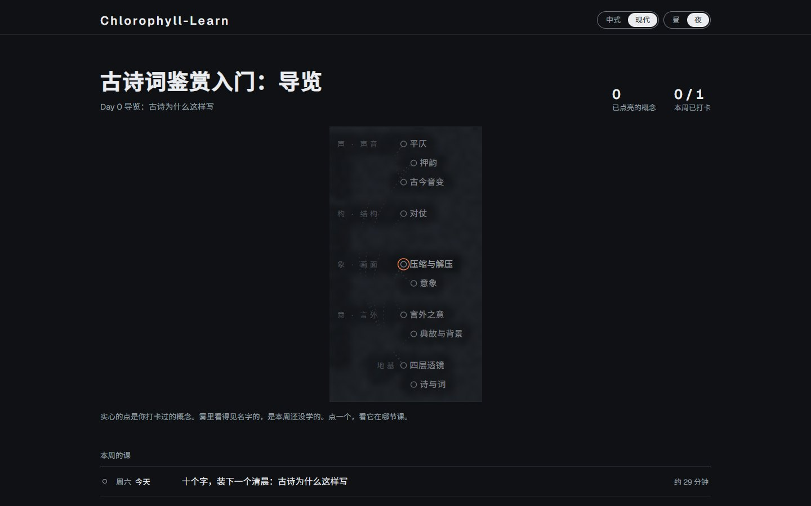
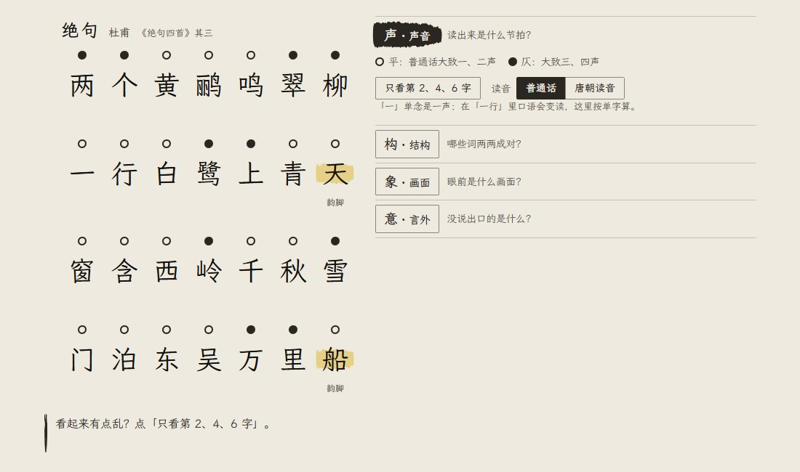
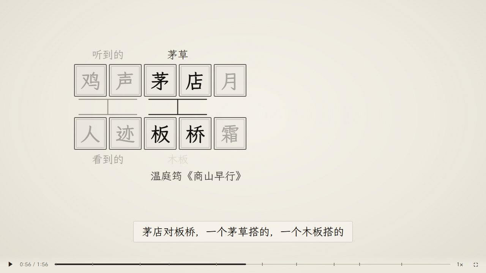
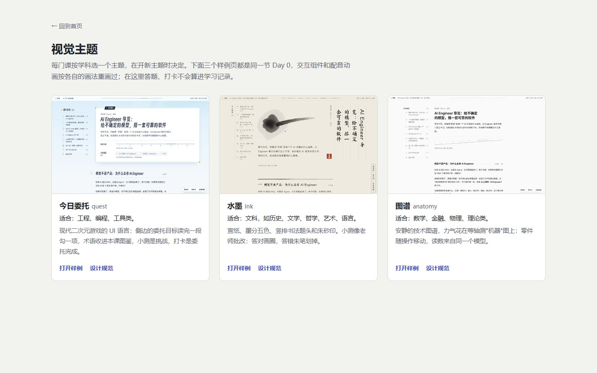

# Chlorophyll-Learn

别人帮你生成一节课，Chlorophyll-Learn 陪你上完一个学期。

一个 Claude Code 插件：按周生成多模态课程（文字、交互组件、配音动画、小测），由 Claude Code 当你的老师，带你一周一周学下去。


下面的截图都来自用本插件生成的一节演示课：「古诗词鉴赏入门」的 Day 0，学习者是虚构的，没有配 TTS key，所以配音动画是字幕版。

| 首页和迷雾知识地图 | 交互组件：用四层透镜读《绝句》 |
|---|---|
|  |  |

| 配音动画（字幕版） | 三个视觉主题 |
|---|---|
|  |  |

## 它是什么

Chlorophyll-Learn 安装后，会在你选的文件夹里生成一个学习工作区：一个本地课程网站、几个 Node.js 工具脚本、一份老师规则（`CLAUDE.md`）、5 个 subagent 和 3 个命令。你说想学什么，老师先问清你的起点和目标，写一份对你隐藏的路线图，然后按周生成课程。课在浏览器里上；Claude Code 是老师，每天读你的学习记录、回答问题，并按你的表现调整后面几天的课。所有文件都在你自己的电脑上，用的是你自己的 Claude Code 登录额度。

## 一周怎么过

| 时间 | 做什么 | 命令 |
|---|---|---|
| 第一次 | 访谈，建隐藏路线图，生成 Day 0 导览课（陌生领域，≤ 30 分钟），或者直接进入第 1 周 | `/new-topic <主题>` |
| 周一到周五 | 每天一节课，以“看”为主，默认不超过 55 分钟（访谈时可以改） | 上课前 `/today` |
| 周六、周日 | 以“练”为主，不限时：复习这周没懂的地方，做练习；然后生成下一周的课 | 直接和老师说；`/build-week` |

`/today` 会先处理上次以来的打卡、小测和问题，再打开今天的课；昨天哪里没懂、错得多，老师会在终端里用几句话先讲清楚。

## 主要功能

- **整周课件，多个 subagent 分工**：planner 规划，writer（文字）、viz（交互组件）、media（配音动画）并行制作，reviewer 核对事实、逐张看截图，有问题退回修复。你拿到的每节课都经过审核。
- **交互组件**：能动手改参数、马上看到结果，用来获得文字给不了的手感。
- **双人配音动画**：画面和配音同步，可以拖动、倍速，也可以导出 mp4；没有配音 key 时自动变成带字幕的无配音版本。
- **隐藏路线图**：路线图只有 planner 看，老师和课件都不提以后会学什么。你每次只需要面对这一周。
- **深挖拦截和停车场**：问到需要先打基础的内容时，老师用几句话给出直觉，把问题存进停车场（`learner/parking-lot.md`），之后再讲，避免在基础不够时跑偏。
- **做题只给提示**：做小测和练习时，老师只给提示和追问；你明确要答案才给，相关概念会标成“模糊”，之后多复习。依据是 Bastani 等的对照实验：直接给答案的 AI 让练习变容易、考试变差，只给提示的没有这个损失。
- **课程页里的「问老师」**：边看边问，按同样的规则回答，并告诉你这条是当场讲完、存进想深挖，还是存进周末问。可以「发送，稍后看」，答好了按钮上有角标。
- **先猜再看、延迟检索**：每段先猜一题再看讲解；每节课开头的热身题考前一天和更早学过的概念。
- **讲给老师听**：课末打卡用自己的话讲一遍今天最重要的东西，第二天 `/today` 告诉你讲对了什么、漏了什么。
- **回指回看**：课文提到以前学过的题、讲解或你的留言时，点开小窗就能看到当时的版本。
- **按学习数据调整**：本地服务器记录每段用时、作答、「暂停」和「犯困了」。`pace_factor`（实际用时 ÷ 预计用时）用来校准之后课程的分钟数；正确率、难度或用时偏离目标时，planner 在后台调整后几天的课。
- **按周的节奏和迷雾地图**：首页按周列出课程；迷雾地图把已开放各周的概念画成节点和连线：打卡过的概念是实心的，本周还没学的在雾里，没开放的部分不显示。
- **三个视觉主题**：quest（工程、编程）、ink（文科）、anatomy（数学、金融、理论），开新主题时按学科推荐。

## 和同类的区别

已经有一些 Claude Code skill 能帮你学东西，例如 Matt Pocock 的 `/teach`：一次生成一节轻量的 HTML 课，上手快，用量也少。Chlorophyll-Learn 更重：一次生成一整周，由多个 subagent 分工和审核，再用每天的 `/today` 把打卡、提问和课程调整串起来。想快速弄懂一个话题，轻量的 skill 更合适；想花几周时间系统学一门东西，可以试试这个。

## 需要什么

- [Claude Code](https://claude.com/claude-code)，已登录
- Node.js ≥ 22（`node -v` 查看）
- Chrome 或 Edge：QA 截图和导出 mp4 都用它。用电脑上已有的就行，不用另装浏览器；找不到时可以在 `.env` 里用 `CHROME_BIN` 指定路径
- 可选：ffmpeg。有配音和导出 mp4 时需要
- 可选：MiniMax 或 ElevenLabs 的 API key，用来配音。没有的话，配音动画自动变成带字幕的无配音版本

## 安装

1. 在 Claude Code 里添加 marketplace：

   ```
   /plugin marketplace add matt-chlorophyll/chlorophyll-learn
   ```

2. 安装插件：

   ```
   /plugin install chlorophyll-learn@chlorophyll
   ```

3. 生成学习工作区：

   ```
   /chlorophyll-learn:setup
   ```

   选一个文件夹，setup 会在里面生成课程网页、工具脚本、老师规则、5 个 subagent 和 3 个命令，并检查环境。

4. 在那个文件夹里重新打开 Claude Code：

   ```
   cd <文件夹>
   claude
   ```

5. 开始一个主题：

   ```
   /new-topic <想学的主题>
   ```

   老师会问几个问题（最多 2 轮），然后生成 Day 0 导览课；如果你在这个领域已经有实际经验，会跳过 Day 0，提示你运行 `/build-week 1`。

想先看看一节课是什么样：启动课程网站（见下面「日常使用」）后打开 <http://localhost:4321/lab/example/>。那是一节完整的示例课（上面截图里的古诗词 Day 0），不计入学习记录，也不花额度。

setup 会在工作区里建好 `.env`。要配音的话，自己打开它填上 MiniMax 或 ElevenLabs 的 key。`.env` 不会进 git，也不要把 key 贴进对话。

## 日常使用

**上课**：Windows 双击工作区里的 `start.cmd`，macOS、Linux 运行 `./start.sh`，浏览器会打开 <http://localhost:4321/>。也可以直接在 Claude Code 里运行 `/today`，它会启动服务器并打开今天的课。

**命令**

| 命令 | 什么时候用 | 做什么 |
|---|---|---|
| `/new-topic <主题>` | 开始一门新课 | 访谈 → 隐藏路线图 → Day 0 导览课或第 1 周 |
| `/today` | 每天上课前 | 处理上次以来的学习记录，打开今天的课；需要时在后台调整后几天 |
| `/build-week [N] [lite]` | 周末 | 生成第 N 周（默认下一周）；加 `lite` 是轻量档 |
| `/chlorophyll-learn:setup` | 安装、更新平台 | 生成工作区，或者更新平台文件 |

**提问**：上课时用课程页的「问老师」，或者直接在 Claude Code 里问。课程页上看不懂的地方点「这里没懂」，`/today` 会处理。

**周末**：周末练习和每周复盘在 v0.1 还没做成命令。直接在 Claude Code 里跟老师说要做周末练习，老师会带你复习本周没懂的地方、标成“模糊”的概念和停车场里的周末问，需要时出练习题。然后运行 `/build-week` 生成下一周。

## 额度和时间

Chlorophyll-Learn 比较重，生成课程要用不少额度。

- **完整档**（`/build-week`）：一周约 3–4 小时，期间 Claude Code 窗口要一直开着。每天会调用 writer、viz、media、reviewer 等多个 subagent，加上修复轮；subagent 默认用 Opus。生成完会在后台导出 mp4（需要 ffmpeg）。
- **轻量档**（`/build-week N lite`）：时间约一半。每天最多 1 个交互组件、1 个配音动画；writer、viz、media 用 Sonnet；审核抽查截图；每天最多修 1 轮；不导出 mp4。
- **额度少的方案（例如 Pro）**：先用 `lite` 试一周，生成前后看 `/usage`，再决定用哪一档。还不够的话，可以把 `.claude/agents/` 里对应 agent 的 `model` 改成 `sonnet`（先改 writer）。
- **「问老师」**：每次提问调用一次 `claude -p`，也用你的额度。默认 Sonnet、低思考强度，可以在 `.env` 里用 `ASK_MODEL`、`ASK_EFFORT` 修改。
- **`/today`**：平时只读记录、更新记忆；需要调整后几天的课时，会在后台派 planner 并重做一部分课件，这时用量会多一些。

## 隐私

- Chlorophyll-Learn 没有云端服务，不收集任何数据。学习记录（打卡、作答、用时、提问）只存在你电脑上的工作区里。
- 老师读这些记录、回答问题时，内容会和平常使用 Claude Code 一样发给 Claude。配了 TTS key 时，配音稿会发给 MiniMax 或 ElevenLabs 合成语音。
- API key 放在 `.env`，它在 `.gitignore` 里，不会进 git。
- 工作区如果用 git 并推到远端，远端仓库要设成**私有**：里面有你的学习档案和隐藏路线图。
- 想保留“不剧透”的体验，就别自己打开 `curriculum/` 里的路线图和 spec。

## 更新

1. 更新插件（在终端里运行，然后重启 Claude Code）：

   ```
   claude plugin marketplace update chlorophyll
   claude plugin update chlorophyll-learn@chlorophyll
   ```

2. 在工作区里打开 Claude Code，再运行一次：

   ```
   /chlorophyll-learn:setup
   ```

   setup 只更新平台文件，不碰学习记录和课程。你（或老师）改过的平台文件：新版本没改的，保留你的版本；新版本也改了的，换成新版本，你的版本先备份到 `.chlorophyll/backup/`，老师可以帮你把改动合并回去。更新后重新打开 Claude Code，新的 subagent 和命令才会生效。

## 现状和已知限制

这是 v0.1。

- 只有简体中文：老师、课程和网页都是中文。
- 周末练习和每周复盘还没做成命令，由老师在对话里手动带。
- 主要在一个主题（作者自己在学的 AI 工程）上用过，其他学科刚开始试。
- 主要在 Windows 上用过；macOS、Linux 的启动脚本 `start.sh` 还没在真机上跑过。
- 比较重，费额度，见「额度和时间」。生成一周时 Claude Code 窗口要一直开着。

欢迎反馈，用起来哪里不顺都可以说。

## 反馈

在 [GitHub issues](https://github.com/matt-chlorophyll/chlorophyll-learn/issues) 里开 issue，有三个模板：

- **装不上 / 跑不起来**：附上系统、Node.js 版本、Claude Code 版本、在哪一步、报错原文
- **课程质量**：哪个主题、第几周第几天、哪里不对，最好附截图
- **建议**

不要在 issue 里贴 API key。学习档案和打卡内容可能有个人信息，只贴必要的片段。

## 第三方

- [three.js](https://threejs.org/)（MIT），用于 3D 交互组件和动画，在 `template/site/assets/vendor/three/`，许可证见 [`template/site/assets/vendor/three/LICENSE`](template/site/assets/vendor/three/LICENSE)。
- 拨云（Boyun）设计系统：课程首页（hub）用的设计系统，在 `template/site/assets/boyun/`。它是作者自己的设计系统，随本仓库以 MIT 开源。

## 名字的来历

作者小时候喜欢生物，很喜欢叶绿素。学习可以像叶绿素一样，把阳光转化成能量，是一个积极向上的过程。作者正在用这个平台学 AI 工程，边学边改进它。

## 许可证

[MIT](LICENSE) © 2026 Matt Yang
